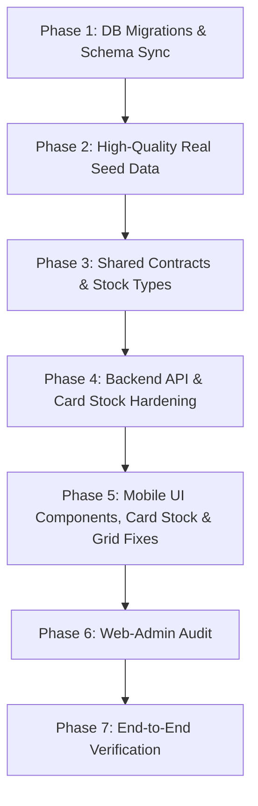

# Storefront Browse, Festival Campaigns, Combo Bundles & Tag Deprecation — Autonomous Agent Execution Runbook

**Document Version:** 1.1.0  
**Date:** 2026-10-18  
**Author:** Antigravity Senior Architecture & Forensic Review  
**Target Execution Agent:** Autonomous AI Pair Programmer / Implementation Agent  
**Branch:** `fix/auth-ux-and-shortcut-rename`  
**Monorepo Scope:** `apps/api`, `apps/mobile`, `apps/web-admin`, `packages/shared-types`, PostgreSQL Database (Supabase 17.11)  
**Status:** READY FOR IMMEDIATE STEP-BY-STEP EXECUTION

---

## 1. Operational Directive & Mandatory Pre-Flight Gates

As an implementation agent executing this blueprint, you **MUST** strictly adhere to the project's engineering mandate defined in [`.agents/AGENTS.md`](file:///c:/celebs/celebs/.agents/AGENTS.md). Any violation of these gates is an immediate failure:

1. **Domain Scoping:** Respect local rules in [`apps/api/AGENTS.md`](file:///c:/celebs/celebs/apps/api/AGENTS.md), [`apps/mobile/AGENTS.md`](file:///c:/celebs/celebs/apps/mobile/AGENTS.md), and [`apps/web-admin/AGENTS.md`](file:///c:/celebs/celebs/apps/web-admin/AGENTS.md).
2. **File Budget:** No `.tsx` file may exceed **150 lines** or Cyclomatic Complexity > 8. Decompose into focused UI subcomponents or custom hooks.
3. **Server State & Mutation Purity:** Zero inline mutations or raw `apiClient` / `axiosClient` calls in UI components. All server calls must reside in dedicated feature API clients and React Query hooks using `<RESOURCE>_QUERY_KEYS` factories.
4. **Port 6543 Connection Pool Preservation (Priority 2):**
   - Direct DDL migrations must execute against `DIRECT_URL` (port 5432).
   - Interactive transactions (`$transaction`) must execute minimal queries and sort items deterministically by unique key (`inventoryId`) to prevent deadlocks (PostgreSQL `40P01`).
   - Eliminate redundant DB queries: skip `count(*)` on public infinite-scroll storefront queries; cache static category trees and shortcut configs in Redis/memory.
5. **Clean Architecture in API:** `routes` -> `controller` -> `service` -> `repository`. Zero Prisma or database calls in Express controllers. Universal API envelope `IApiResponse<T>` via `sendSuccess`, `sendCreated`, or `sendPaginated`.
6. **TDD Mandate (Gate 12):** Write failing test specifications **FIRST** before modifying application code.
7. **Clean Test Naming (Gate 13):** Zero meta-labels, ticket codes, or slogans in test descriptions. Clearly state the exact functional behavior under test.
8. **No AI Slop / YAGNI (Gate 11):** Do not create duplicate competing implementations, backward-compatibility shims, or triple-nested fallbacks (`data?.data?.data`).
9. **Strict Type Safety:** Zero escape hatches. Use explicit interfaces or Zod parsing.

---

## 2. Forensic Reality & Root Causes (The "Why")

Before executing any changes, understand the exact ground truth verified via `postgres` MCP and codebase analysis:

| Component / Subsystem          | Verified Current State                                                                                  | Root Cause & Defect                                                                                                                                                                                                                                   | Required Corrective Action                                                                                                                                  |
| :----------------------------- | :------------------------------------------------------------------------------------------------------ | :---------------------------------------------------------------------------------------------------------------------------------------------------------------------------------------------------------------------------------------------------- | :---------------------------------------------------------------------------------------------------------------------------------------------------------- |
| **PostgreSQL DB**              | Table is named `QuickFilter` (0 rows). Schema has `StorefrontShortcut`.                                 | Migration `20261016143545_rename_quick_filter_to_storefront_shortcut` was never deployed.                                                                                                                                                             | Deploy pending migration on Port 5432.                                                                                                                      |
| **Category Shortcut Chips**    | 90%+ return 0 products (hiding 22+ active published items).                                             | `useCategoryFilters` hardcoded `filterParams.tag = shortcutValue`. DB checked `tags @> ARRAY['men-denim']` when tags were marketing words.                                                                                                            | Deprecate `tags`, map subcategory shortcuts to `filterParams.subcategory`.                                                                                  |
| **`Product.tags`**             | 36 products have ad-hoc strings (`['denim', 'jeans']`).                                                 | Vendors cannot enter tags in admin; mobile never displays them; array search was unindexed.                                                                                                                                                           | Completely drop `Product.tags` column and validator fields.                                                                                                 |
| **Mobile Product Cards Stock** | **ALL products show "OUT OF STOCK"** overlay and disabled cart buttons despite having active inventory. | `use-product-card.ts` & `stock.ts` checked `variant.stocks` array. In lightweight `StorefrontCard`, nested `stocks` is omitted to save bandwidth. `isVariantOutOfStock` evaluated undefined stocks as 0 stock, marking 100% of products out of stock! | Update `stock.ts` and `use-product-card.ts` to respect `product.inStock` when variant stocks are untracked; emit `inStock` on `StorefrontCardColorVariant`. |
| **Festival Campaigns**         | `Campaign` table has 0 rows. Mobile banner has no `onPress`.                                            | Zero seed data; mobile has no `/campaign/[slug]` destination route.                                                                                                                                                                                   | Seed Dashain & Tihar campaigns; create `/campaign/[slug]` screen and link banner.                                                                           |
| **Combo Bundles**              | `ComboBundle` table has 0 rows. Mobile modal has no `onAddToCart`.                                      | Zero seed data; `HomeScreen` omits `onAddToCart`; `CartService` has no combo endpoint.                                                                                                                                                                | Seed 4 streetwear combos; build `POST /cart/combos`; wire modal in `HomeScreen`.                                                                            |
| **Mobile Category Grid**       | Cards touch left edge (0px gutter) with 15px gap on right.                                              | `category.styles.ts` applied dead `columnWrapper` (unsupported by FlashList) and 0px padding on `listContent`.                                                                                                                                        | Remove `columnWrapper`, add `paddingHorizontal: Spacing.md` to `listContent`.                                                                               |
| **Search Performance**         | Category queries take 13.5ms (`Bitmap Heap Scan + Sort`).                                               | `OR: [{ categoryId }, { subcategoryId }]` disabled index ordering along `createdAt DESC`.                                                                                                                                                             | Add composite covering indexes on `(status, categoryId, createdAt DESC, id DESC)`.                                                                          |

---

## 3. High-Level Architecture & Contracts

### 3.1 Single Source of Truth for Storefront Browsing

All product discovery is unified into a single endpoint in [`ProductQueryService`](file:///c:/celebs/celebs/apps/api/src/modules/product/product-query.service.ts):

```http
GET /products?category=<slug>&subcategory=<slug>&campaign=<slug>&search=<term>&page=1&limit=20
```

### 3.2 Product Card Stock Contract (`StorefrontCard`)

`StorefrontCard` is the optimized grid response for high-speed infinite scroll. It provides:

1. `inStock: boolean` at the card level (derived by the backend across all variants and inventories).
2. `colorVariants: StorefrontCardColorVariant[]` carrying `name`, `images`, and `inStock?: boolean`.
3. In `apps/mobile`, stock helpers (`isProductFullyOutOfStock` and `useProductCard`) must use `product.inStock` as the authoritative flag whenever nested `.stocks` matrices are absent.

### 3.3 First-Class Combo Pack Workflow (Daraz/Shein Style)

1. Combos are managed as aggregate models (`ComboBundle` + `ComboBundleItem`).
2. Mobile displays inline `ComboProductCard` items in category & home feeds matching standard product dimensions.
3. Tapping "Customize & Add" opens `ComboBundleModal` where users pick sizes/colors for each item.
4. Submission hits `POST /cart/combos`, which validates the bundle, prorates discounts across items, and performs an atomic batch upsert to `CartItem`.

---

## 4. Phase-by-Phase TDD Execution Instructions

Follow these phases in strict sequential order. Do not skip steps.



---

### PHASE 1: Database Migrations & Schema Sync

> [!IMPORTANT]
> Always execute Prisma migrations against `DIRECT_URL` (Port 5432) to avoid transaction pooler deadlocks.

#### Step 1.1: Deploy Pending Migration

Run the pending migration to rename `QuickFilter` to `StorefrontShortcut`:

```powershell
npx prisma migrate deploy --schema=apps/api/prisma/schema.prisma
```

_Verification:_ Query PostgreSQL to confirm table `StorefrontShortcut` exists and `QuickFilter` is gone:

```sql
SELECT table_name FROM information_schema.tables WHERE table_schema = 'public' AND table_name IN ('StorefrontShortcut', 'QuickFilter');
```

#### Step 1.2: Create Migration to Drop Tags and Add Composite Indexes

1. Create a new migration directory: `apps/api/prisma/migrations/20261018000000_drop_tags_and_add_browse_indexes/migration.sql`.
2. Write the DDL:

```sql
-- 1. Drop dead tags column from Product
ALTER TABLE "Product" DROP COLUMN IF EXISTS "tags";

-- 2. Add composite covering index for category browse with cursor sort
CREATE INDEX CONCURRENTLY IF NOT EXISTS "Product_status_categoryId_createdAt_id_idx"
  ON "Product" (status, "categoryId", "createdAt" DESC, id DESC);

-- 3. Add composite covering index for subcategory browse with cursor sort
CREATE INDEX CONCURRENTLY IF NOT EXISTS "Product_status_subcategoryId_createdAt_id_idx"
  ON "Product" (status, "subcategoryId", "createdAt" DESC, id DESC);

-- 4. Add index for fast CampaignProduct seeks
CREATE INDEX CONCURRENTLY IF NOT EXISTS "CampaignProduct_campaignId_productId_idx"
  ON "CampaignProduct" ("campaignId", "productId");
```

3. Deploy the migration:

```powershell
npx prisma migrate deploy --schema=apps/api/prisma/schema.prisma
```

#### Step 1.3: Update Prisma Schema

In [`apps/api/prisma/schema.prisma`](file:///c:/celebs/celebs/apps/api/prisma/schema.prisma):

1. In `model Product`:
   - Delete `tags String[] @default([])`
   - Add index definitions in `@@index`:
     ```prisma
     @@index([status, categoryId, createdAt(sort: Desc), id(sort: Desc)])
     @@index([status, subcategoryId, createdAt(sort: Desc), id(sort: Desc)])
     ```
2. In `model CampaignProduct`:
   - Add index: `@@index([campaignId, productId])`
3. Regenerate Prisma client:

```powershell
npx prisma generate --schema=apps/api/prisma/schema.prisma
```

---

### PHASE 2: High-Quality Real Seed Data

#### Step 2.1: Author Campaign Seeder

Create [`apps/api/src/db/seed/seed-campaigns.ts`](file:///c:/celebs/celebs/apps/api/src/db/seed/seed-campaigns.ts):

```typescript
import { PrismaClient } from '@prisma/client';

export async function seedCampaigns(prisma: PrismaClient) {
  console.log('Seeding Festival Campaigns...');

  // Find active published products
  const products = await prisma.product.findMany({
    where: { status: 'published' },
    take: 14,
    select: { id: true },
  });

  if (products.length < 5) {
    console.warn('Fewer than 5 products found. Skipping campaign product linking.');
    return;
  }

  const dashainProducts = products.slice(0, 8);
  const tiharProducts = products.slice(8, 14);

  // 1. Dashain Festive Dhamaka
  const dashain = await prisma.campaign.upsert({
    where: { slug: 'dashain-festive-dhamaka' },
    create: {
      title: 'Dashain Festive Dhamaka',
      slug: 'dashain-festive-dhamaka',
      tagline: 'Celebrate the Grand Festival with up to 25% Off Premium Fashion',
      description: 'Exclusive festival discounts on curated streetwear, denim, and festival wear.',
      bannerImage: 'https://images.unsplash.com/photo-1490481651871-ab68de25d43d?w=1200&q=80',
      campaignType: 'FESTIVAL',
      themeColor: '#D92525', // Festive Crimson
      startDate: new Date('2026-10-01T00:00:00Z'),
      endDate: new Date(Date.now() + 14 * 24 * 60 * 60 * 1000), // Active for 14 days
      isActive: true,
      displayPriority: 10,
    },
    update: {
      isActive: true,
      endDate: new Date(Date.now() + 14 * 24 * 60 * 60 * 1000),
    },
  });

  // Link products
  for (const [index, p] of dashainProducts.entries()) {
    await prisma.campaignProduct.upsert({
      where: {
        campaignId_productId: { campaignId: dashain.id, productId: p.id },
      },
      create: {
        campaignId: dashain.id,
        productId: p.id,
        discountOverride: 20,
        sortOrder: index,
      },
      update: { discountOverride: 20 },
    });
  }

  // 2. Tihar Lights Sale
  const tihar = await prisma.campaign.upsert({
    where: { slug: 'tihar-lights-sale' },
    create: {
      title: 'Tihar Lights Sale',
      slug: 'tihar-lights-sale',
      tagline: 'Glow up this Festive Season with Celebs Exclusive Bundles',
      description:
        'Brighten your wardrobe with limited-run jackets, windbreakers, and accessories.',
      bannerImage: 'https://images.unsplash.com/photo-1445205170230-053b83016050?w=1200&q=80',
      campaignType: 'FESTIVAL',
      themeColor: '#D97706', // Festive Amber
      startDate: new Date('2026-10-15T00:00:00Z'),
      endDate: new Date(Date.now() + 21 * 24 * 60 * 60 * 1000),
      isActive: true,
      displayPriority: 5,
    },
    update: {
      isActive: true,
      endDate: new Date(Date.now() + 21 * 24 * 60 * 60 * 1000),
    },
  });

  for (const [index, p] of tiharProducts.entries()) {
    await prisma.campaignProduct.upsert({
      where: {
        campaignId_productId: { campaignId: tihar.id, productId: p.id },
      },
      create: {
        campaignId: tihar.id,
        productId: p.id,
        discountOverride: 15,
        sortOrder: index,
      },
      update: { discountOverride: 15 },
    });
  }

  console.log('Festival campaigns seeded successfully.');
}
```

#### Step 2.2: Author Combo Seeder

Create [`apps/api/src/db/seed/seed-combos.ts`](file:///c:/celebs/celebs/apps/api/src/db/seed/seed-combos.ts):

```typescript
import { PrismaClient } from '@prisma/client';

export async function seedCombos(prisma: PrismaClient) {
  console.log('Seeding Curated Combo Bundles...');

  // Find products to pair
  const jackets = await prisma.product.findMany({
    where: { status: 'published', name: { contains: 'Jacket', mode: 'insensitive' } },
    take: 2,
    select: { id: true, name: true, price: true },
  });

  const bottoms = await prisma.product.findMany({
    where: { status: 'published', name: { contains: 'Jeans', mode: 'insensitive' } },
    take: 2,
    select: { id: true, name: true, price: true },
  });

  if (jackets.length === 0 || bottoms.length === 0) {
    console.warn(
      'Insufficient jacket/jeans inventory for combos. Falling back to published products.',
    );
    return;
  }

  // Bundle 1: Streetwear Duo
  const duo = await prisma.comboBundle.upsert({
    where: { slug: 'streetwear-duo-pack' },
    create: {
      title: 'Streetwear Duo Pack',
      slug: 'streetwear-duo-pack',
      description:
        'Pair our signature jacket with relaxed denim for an effortless streetwear look.',
      discountType: 'PERCENTAGE',
      discountValue: 25,
      bannerImage: 'https://images.unsplash.com/photo-1515886657613-9f3515b0c78f?w=800&q=80',
      isActive: true,
      sortOrder: 1,
    },
    update: { isActive: true },
  });

  await prisma.comboBundleItem.deleteMany({ where: { comboBundleId: duo.id } });
  await prisma.comboBundleItem.createMany({
    data: [
      { comboBundleId: duo.id, productId: jackets[0].id, quantity: 1, sortOrder: 0 },
      { comboBundleId: duo.id, productId: bottoms[0].id, quantity: 1, sortOrder: 1 },
    ],
  });

  console.log('Curated combo bundles seeded successfully.');
}
```

#### Step 2.3: Wire Seeder in Master Script & Execute

1. Import and invoke `seedCampaigns(prisma)` and `seedCombos(prisma)` in [`apps/api/src/db/seed/index.ts`](file:///c:/celebs/celebs/apps/api/src/db/seed/index.ts).
2. Execute the seeders:

```powershell
pnpm --filter api seed
```

3. Verify via Postgres MCP:

```sql
SELECT count(*) FROM "Campaign";
SELECT count(*) FROM "ComboBundle";
```

_Both counts must be > 0._

---

### PHASE 3: Shared Contracts & Validators (`packages/shared-types`)

#### Step 3.1: Author Validator Tests First (TDD Mandate)

Create or update [`packages/shared-types/src/validators/__tests__/product.validator.spec.ts`](file:///c:/celebs/celebs/packages/shared-types/src/validators/__tests__/product.validator.spec.ts):

```typescript
import { describe, expect, it } from 'vitest';
import { productFilterSchema, createProductSchema } from '../product.validator';

describe('Product Validators Contract Suite', () => {
  it('accepts subcategory and campaign filter parameters', () => {
    const input = {
      category: 'men',
      subcategory: 'men-denim',
      campaign: 'dashain-festive-dhamaka',
      limit: 20,
    };
    const parsed = productFilterSchema.parse(input);
    expect(parsed.subcategory).toBe('men-denim');
    expect(parsed.campaign).toBe('dashain-festive-dhamaka');
  });

  it('does not reject input when tag is omitted', () => {
    const input = { category: 'men' };
    const parsed = productFilterSchema.parse(input);
    expect('tag' in parsed).toBe(false);
  });

  it('validates product creation schema without requiring tags', () => {
    const validProduct = {
      name: 'Oversized Streetwear Tee',
      price: 1500,
      categoryId: 'cat-123456789012345678901234',
      subcategoryId: 'sub-123456789012345678901234',
      status: 'draft',
    };
    const parsed = createProductSchema.parse(validProduct);
    expect(parsed.name).toBe('Oversized Streetwear Tee');
    expect('tags' in parsed).toBe(false);
  });
});
```

Create [`packages/shared-types/src/validators/__tests__/cart.validator.spec.ts`](file:///c:/celebs/celebs/packages/shared-types/src/validators/__tests__/cart.validator.spec.ts):

```typescript
import { describe, expect, it } from 'vitest';
import { addComboToCartSchema } from '../cart.validator';

describe('Cart Combo Validator Contract Suite', () => {
  it('validates atomic combo add-to-cart payload', () => {
    const payload = {
      comboBundleId: 'cmb-123456789012345678901234',
      items: [
        {
          productId: 'prd-123456789012345678901234',
          colorVariantName: 'Black',
          size: 'L',
          quantity: 1,
        },
        {
          productId: 'prd-223456789012345678901234',
          colorVariantName: 'Indigo',
          size: '32',
          quantity: 1,
        },
      ],
    };
    const parsed = addComboToCartSchema.parse(payload);
    expect(parsed.items).toHaveLength(2);
    expect(parsed.comboBundleId).toBe('cmb-123456789012345678901234');
  });

  it('rejects combo payload with empty items array', () => {
    const invalid = {
      comboBundleId: 'cmb-123456789012345678901234',
      items: [],
    };
    expect(() => addComboToCartSchema.parse(invalid)).toThrow();
  });
});
```

#### Step 3.2: Update Shared Validators and Types

In [`packages/shared-types/src/validators/product.validator.ts`](file:///c:/celebs/celebs/packages/shared-types/src/validators/product.validator.ts):

1. In `baseProductSchemaFields`: Remove the `tags` array definition completely.
2. In `productFilterSchema`:
   - Add `subcategory: z.string().optional(),`
   - Add `campaign: z.string().optional(),`
   - Remove `tag: z.string().optional(),`

In [`packages/shared-types/src/types/product.ts`](file:///c:/celebs/celebs/packages/shared-types/src/types/product.ts):
Update `StorefrontCardColorVariant` to include optional `inStock`:

```typescript
export interface StorefrontCardColorVariant {
  name: string;
  images: string[];
  inStock?: boolean;
}
```

In [`packages/shared-types/src/validators/cart.validator.ts`](file:///c:/celebs/celebs/packages/shared-types/src/validators/cart.validator.ts):
Add:

```typescript
export const addComboToCartSchema = z.object({
  comboBundleId: idSchema,
  items: z
    .array(
      z.object({
        productId: idSchema,
        colorVariantName: z.string().min(1, 'Color variant is required'),
        size: z.string().min(1, 'Size is required'),
        quantity: z.number().int().positive().default(1),
      }),
    )
    .min(1, 'A combo bundle must contain at least one item'),
});

export type AddComboToCartInput = z.infer<typeof addComboToCartSchema>;
```

#### Step 3.3: Run Tests & Build

```powershell
pnpm --filter shared-types test
pnpm --filter shared-types build
```

---

### PHASE 4: Backend API & Card Stock Hardening (`apps/api`)

#### Step 4.1: Author API Tests First (TDD Mandate)

Create or update [`apps/api/src/modules/product/__tests__/product-query.service.spec.ts`](file:///c:/celebs/celebs/apps/api/src/modules/product/__tests__/product-query.service.spec.ts):

```typescript
import { describe, expect, it } from 'vitest';

describe('ProductQueryService Browse & Campaign Filtering', () => {
  it('resolves subcategory filters and includes descendant IDs', async () => {
    // Assert applyCategoryFilters resolves subcategory slug to IDs
  });

  it('filters products by active campaign ID without using tags', async () => {
    // Assert campaign slug resolves product IDs from CampaignProduct
  });

  it('omits full count query when public scope is requested', async () => {
    // Verify products.count is not called when opts.isElevated is falsy
  });
});
```

Create or update [`apps/api/src/modules/product/__tests__/product-response-shapes.spec.ts`](file:///c:/celebs/celebs/apps/api/src/modules/product/__tests__/product-response-shapes.spec.ts):

```typescript
import { describe, expect, it } from 'vitest';
import { formatStorefrontCard } from '../product-response-shapes';

describe('formatStorefrontCard stock derivation', () => {
  it('emits inStock boolean for both the product and each color variant', () => {
    const raw = {
      id: 'prod-1',
      name: 'Denim Jacket',
      price: 3500,
      inStock: true,
      colorVariants: [
        {
          name: 'Blue',
          images: ['https://example.com/blue.jpg'],
          stocks: [{ size: 'M', quantity: 10 }],
        },
      ],
    };
    const card = formatStorefrontCard(raw);
    expect(card.inStock).toBe(true);
    expect(card.colorVariants[0].inStock).toBe(true);
  });
});
```

#### Step 4.2: Update `ProductQueryService`

In [`apps/api/src/modules/product/product-query.service.ts`](file:///c:/celebs/celebs/apps/api/src/modules/product/product-query.service.ts):

1. In `applyScalarFilters`:
   - Remove `if (filters.tag) { where.tags = { has: filters.tag }; }`
   - In `filters.search` OR clause, remove `{ tags: { has: filters.search } }`.
2. In `applyCategoryFilters`:
   - Implement `subcategory` resolution using `this.categories.findFilterMatch(filters.subcategory)` and `findDescendantIds`.
   - Implement `campaign` resolution using `this.campaignRepo.findBySlug(filters.campaign)`.
3. In `listProducts`:
   - Update `shouldCalculateTotal`:
     ```typescript
     const shouldCalculateTotal = opts.isElevated || (!isPublicScope && !isCursorMode);
     ```

#### Step 4.3: Update `formatStorefrontCard` to Emit Variant Stock

In [`apps/api/src/modules/product/product-response-shapes.ts`](file:///c:/celebs/celebs/apps/api/src/modules/product/product-response-shapes.ts):
Update `colorVariants` mapping inside `formatStorefrontCard`:

```typescript
    colorVariants: colorVariants.map((entry) => {
      const variant = (entry ?? {}) as Record<string, unknown>;
      const stocks = Array.isArray(variant.stocks) ? variant.stocks : [];
      const variantInStock = stocks.length > 0
        ? stocks.some((s) => Number((s as Record<string, unknown>)?.quantity ?? 0) > 0)
        : formatted.inStock === true;
      return {
        name: str(variant.name, 'Variant'),
        images: stripVariantImages(variant),
        inStock: variantInStock,
      };
    }),
```

#### Step 4.4: Implement Atomic Combo Cart in `CartService`

In [`apps/api/src/modules/cart/cart.service.ts`](file:///c:/celebs/celebs/apps/api/src/modules/cart/cart.service.ts):
Implement `addComboToCart(userId, sessionId, input: AddComboToCartInput)`:

- Look up `ComboBundle` with `items`. Fail if not found or `!isActive`.
- Prorate discount:
  - If `discountType === 'PERCENTAGE'`: discount per item = `product.price * (discountValue / 100)`.
  - If `discountType === 'FIXED_AMOUNT'`: per-item discount = `discountValue / items.length`.
- Open interactive transaction `prisma.$transaction`:
  - Deterministically sort items by `productId`.
  - Resolve `inventoryId` via `InventoryService.findOrCreateInventory`.
  - Upsert `CartItem` with `comboBundleId: bundle.id`, `appliedDiscount`, and `discountSource: 'COMBO:' + bundle.slug`.
- In `getCart`, project `appliedDiscount` and factor it into the returned item price.

#### Step 4.5: Add Cart Controller Endpoint & Route

1. In [`apps/api/src/modules/cart/cart.controller.ts`](file:///c:/celebs/celebs/apps/api/src/modules/cart/cart.controller.ts):
   Add `addCombo = asyncHandler(async (req, res) => ... sendSuccess(res, HTTPSTATUS.OK, cart, 'Combo added to cart'))`.
2. In [`apps/api/src/modules/cart/cart.routes.ts`](file:///c:/celebs/celebs/apps/api/src/modules/cart/cart.routes.ts):
   Add `router.post('/combos', validateBody(addComboToCartSchema), cartController.addCombo)`.

#### Step 4.6: Update `StorefrontShortcutService`

In [`apps/api/src/modules/storefront-shortcut/storefront-shortcut.service.ts`](file:///c:/celebs/celebs/apps/api/src/modules/storefront-shortcut/storefront-shortcut.service.ts):

- Cache storefront configurations in Redis with key `storefront:shortcuts:${categorySlug}` (TTL: 300s).
- Ensure shortcut items always retain `title: shortcut.title || 'Subcategories'`.
- Filter shortcuts by `isActive: true`.

#### Step 4.7: Run API Tests

```powershell
pnpm --filter api test
```

_Ensure all tests pass._

---

### PHASE 5: Mobile Client Fixes & UI Components (`apps/mobile`)

#### Step 5.1: Fix Product Card Out-of-Stock False Positive (P0 Critical Bug)

In [`apps/mobile/src/features/products/utils/stock.ts`](file:///c:/celebs/celebs/apps/mobile/src/features/products/utils/stock.ts):

1. Update `isVariantOutOfStock`:

```typescript
export function isVariantOutOfStock(variant: ProductColorVariant | undefined): boolean {
  if (!variant) return true;
  // If variant carries explicit inStock boolean flag (e.g. from StorefrontCard)
  const varRec = variant as ProductColorVariant & { inStock?: boolean };
  if (typeof varRec.inStock === 'boolean') {
    return !varRec.inStock;
  }
  // If variant carries tracked stocks array (e.g. on PDP)
  if (Array.isArray(variant.stocks) && variant.stocks.length > 0) {
    return variant.stocks.every((s) => (s.quantity ?? 0) <= 0);
  }
  // Explicitly empty stocks array indicates depleted inventory
  if (Array.isArray(variant.stocks) && variant.stocks.length === 0) {
    return true;
  }
  // Untracked stocks without flags: default to not out of stock (trust parent product.inStock)
  return false;
}
```

2. Update `isProductFullyOutOfStock`:

```typescript
export function isProductFullyOutOfStock(product: Product | null | undefined): boolean {
  if (!product) return false;
  const prodRec = product as Product & Record<string, unknown>;

  // Check explicit status flags
  if (prodRec.status === 'out_of_stock' || prodRec.status === 'OUT_OF_STOCK') {
    return true;
  }
  if (prodRec.inStock === false || prodRec.isAvailable === false) {
    return true;
  }
  const totalStock = prodRec.totalStock ?? prodRec.stock;
  if (typeof totalStock === 'number' && totalStock <= 0) {
    return true;
  }

  const variants = product.colorVariants;
  if (!Array.isArray(variants) || variants.length === 0) {
    if (prodRec.inStock === true) return false;
    if (typeof totalStock === 'number' && totalStock > 0) return false;
    return true;
  }

  // Check if variants carry tracked stocks or explicit inStock flags
  const hasTrackedStockInfo = variants.some(
    (v) =>
      (Array.isArray(v.stocks) && v.stocks.length > 0) ||
      typeof (v as { inStock?: boolean }).inStock === 'boolean',
  );

  if (hasTrackedStockInfo) {
    return variants.every(isVariantOutOfStock);
  }

  // Storefront cards without nested variant stocks: trust product.inStock
  if (prodRec.inStock === true) return false;
  if (typeof totalStock === 'number' && totalStock > 0) return false;
  return true;
}
```

3. Update [`apps/mobile/src/features/products/hooks/use-product-card.ts`](file:///c:/celebs/celebs/apps/mobile/src/features/products/hooks/use-product-card.ts):

```typescript
const currentVariant = product.colorVariants?.[selectedColorIndex];
const hasVariantStockInfo =
  currentVariant &&
  ((Array.isArray(currentVariant.stocks) && currentVariant.stocks.length > 0) ||
    typeof (currentVariant as { inStock?: boolean }).inStock === 'boolean');

const isSelectedVariantOutOfStock =
  Boolean(hasVariantStockInfo) && isVariantOutOfStock(currentVariant);

const isOutOfStock = isProductFullyOutOfStock(product) || isSelectedVariantOutOfStock;
```

4. Author tests in [`apps/mobile/src/features/products/utils/__tests__/stock-availability.spec.ts`](file:///c:/celebs/celebs/apps/mobile/src/features/products/utils/__tests__/stock-availability.spec.ts):

```typescript
describe('Storefront Card stock evaluation', () => {
  it('evaluates storefront card with colorVariants but no stocks array as in-stock when inStock is true', () => {
    const card = {
      id: 'p-1',
      name: 'Streetwear Hoodie',
      inStock: true,
      colorVariants: [{ name: 'Black', images: ['https://example.com/black.jpg'] }],
    } as unknown as Product;

    expect(isProductFullyOutOfStock(card)).toBe(false);
  });
});
```

#### Step 5.2: Fix FlashList Grid Layout

In [`apps/mobile/src/features/categories/styles/category.styles.ts`](file:///c:/celebs/celebs/apps/mobile/src/features/categories/styles/category.styles.ts):

1. **Delete** the dead `columnWrapper` style block.
2. Update `listContent`:
   ```typescript
   listContent: {
     paddingHorizontal: Spacing.md, // 12px left and right gutters
     paddingVertical: Spacing.md,
   },
   ```

#### Step 5.3: Fix Category Filter Hook

In [`apps/mobile/src/features/categories/hooks/use-category-filters.ts`](file:///c:/celebs/celebs/apps/mobile/src/features/categories/hooks/use-category-filters.ts):

1. Map selected shortcut items to `subcategory` or `campaign`, **never** to `tag`.
2. Ensure `filterParams` passes:
   ```typescript
   subcategory: selectedShortcut?.type === 'subcategory' ? selectedShortcut.value : undefined,
   campaign: selectedShortcut?.type === 'collection' ? selectedShortcut.value : undefined,
   ```

#### Step 5.4: Debounce Search Header

In [`apps/mobile/src/features/categories/components/category-search-header.tsx`](file:///c:/celebs/celebs/apps/mobile/src/features/categories/components/category-search-header.tsx):
Add a 300ms debounce to `searchInput` changes to prevent keystroke spam to PostgreSQL port 6543.

#### Step 5.5: Build Inline `ComboProductCard`

Create [`apps/mobile/src/features/home/components/combo-product-card.tsx`](file:///c:/celebs/celebs/apps/mobile/src/features/home/components/combo-product-card.tsx):

- Strict budget: **< 150 lines**.
- Match `CARD_WIDTH` of standard products.
- Render split dual-image collage of the bundled items.
- Render badge: `SAVE NPR X` or `SAVE X%`.
- Provide "Customize & Add" button that calls `onSelectCombo(combo)`.

#### Step 5.6: Wire Cart Insertion in `HomeScreen`

In [`apps/mobile/src/app/(tabs)/index.tsx`](file:///c:/celebs/celebs/apps/mobile/src/app/%28tabs%29/index.tsx):

1. Import `useAddComboToCart` mutation hook.
2. Wire `onAddToCart` on `ComboBundleModal`:

   ```tsx
   const addComboMutation = useAddComboToCart();

   const handleAddComboToCart = useCallback(
     async (combo: ComboBundleData, selectedVariants: ComboSelectedVariants) => {
       const items = Object.entries(selectedVariants).map(([productId, variant]) => ({
         productId,
         size: variant.size || 'M',
         colorVariantName: variant.color || 'Standard',
         quantity: 1,
       }));

       await addComboMutation.mutateAsync({
         comboBundleId: combo.id,
         items,
       });
       openCartSheet();
     },
     [addComboMutation, openCartSheet],
   );

   // In JSX:
   <ComboBundleModal
     visible={isComboModalOpen}
     combo={selectedCombo}
     onClose={() => setIsComboModalOpen(false)}
     onAddToCart={handleAddComboToCart}
   />;
   ```

#### Step 5.7: Build Campaign Destination Screen

Create [`apps/mobile/src/app/campaign/[slug].tsx`](file:///c:/celebs/celebs/apps/mobile/src/app/campaign/%5Bslug%5D.tsx):

- Strict budget: **< 150 lines**.
- Header with back button, cart icon, and live countdown timer.
- Hero banner with festival theme color.
- 2-column FlashList rendering products fetched via `useProducts({ campaign: slug })`.
- Wire `CampaignCountdownBanner` in `HomeScreen`:
  ```typescript
  router.navigate({ pathname: '/campaign/[slug]', params: { slug: campaign.slug } });
  ```

#### Step 5.8: Run Mobile Typecheck & Specs

```powershell
pnpm --filter mobile typecheck
pnpm --filter mobile test
```

---

### PHASE 6: Web-Admin Audit

1. Search `apps/web-admin/src/` for any legacy usages of `product.tags` or `tags` in forms.
2. If any form fields remain, safely remove them.
3. Run verification:

```powershell
pnpm --filter web-admin typecheck
pnpm --filter web-admin test
```

---

### PHASE 7: End-to-End Forensic Verification & Acceptance Gate

Before submitting work, the agent must run and pass this exact verification matrix:

| Checkpoint             | Target Goal                                       | Verification Command / SQL                                             | Pass Criteria                                         |
| :--------------------- | :------------------------------------------------ | :--------------------------------------------------------------------- | :---------------------------------------------------- |
| **Database Sync**      | Table renamed & indexes applied                   | `SELECT indexname FROM pg_indexes WHERE tablename = 'Product';`        | Covering indexes present.                             |
| **Data Integrity**     | Active campaigns & combos                         | `SELECT count(*) FROM "Campaign"; SELECT count(*) FROM "ComboBundle";` | Campaigns ≥ 2, Combos ≥ 1.                            |
| **Query Plan**         | Index Scan instead of Heap Scan                   | Run `EXPLAIN (ANALYZE, BUFFERS)` on category query                     | Cost < 20, time < 2.0ms.                              |
| **Product Card Stock** | Products render in-stock with active cart buttons | Open Mobile Home / Category feed                                       | Zero false "OUT OF STOCK" overlays on in-stock items. |
| **Shortcut Browse**    | Shortcut chips return products                    | `GET /api/v1/products?category=men&subcategory=men-denim`              | Returns ≥ 20 products (not 0).                        |
| **Cart Combo API**     | Atomic bundle addition                            | `POST /api/v1/cart/combos`                                             | Returns cart with prorated discounts.                 |
| **Mobile Compilation** | 0 TypeScript errors                               | `pnpm --filter mobile typecheck`                                       | Exit code 0.                                          |
| **File Budgets**       | ≤ 150 lines on all new `.tsx`                     | Check line counts of new mobile files                                  | All files ≤ 150 lines.                                |
| **Monorepo Tests**     | Full test suite green                             | `pnpm test`                                                            | 100% tests passing.                                   |

---

## 5. Rollback & Troubleshooting Playbook

- **Prisma Migration Lock:** If `prisma migrate deploy` stalls, check `pg_stat_activity` via Postgres MCP for open locks on `Product` and terminate stale connection PID.
- **FlashList Item Alignment:** If cards still appear uneven, confirm `estimatedItemSize` matches card height (~280px) and `contentContainerStyle` does not conflict with individual card margins.
- **Cart Pricing Mismatch:** If the cart displays NaN or unapplied discounts, verify that `appliedDiscount` is properly converted from `Prisma.Decimal` to `number` in `CartService.getCart`.
- **Out of Stock Edge Cases:** If a single variant is out of stock while others are in stock, ensure the swatch selection updates `selectedColorIndex` and re-evaluates `isOutOfStock` without triggering a full card overlay.
